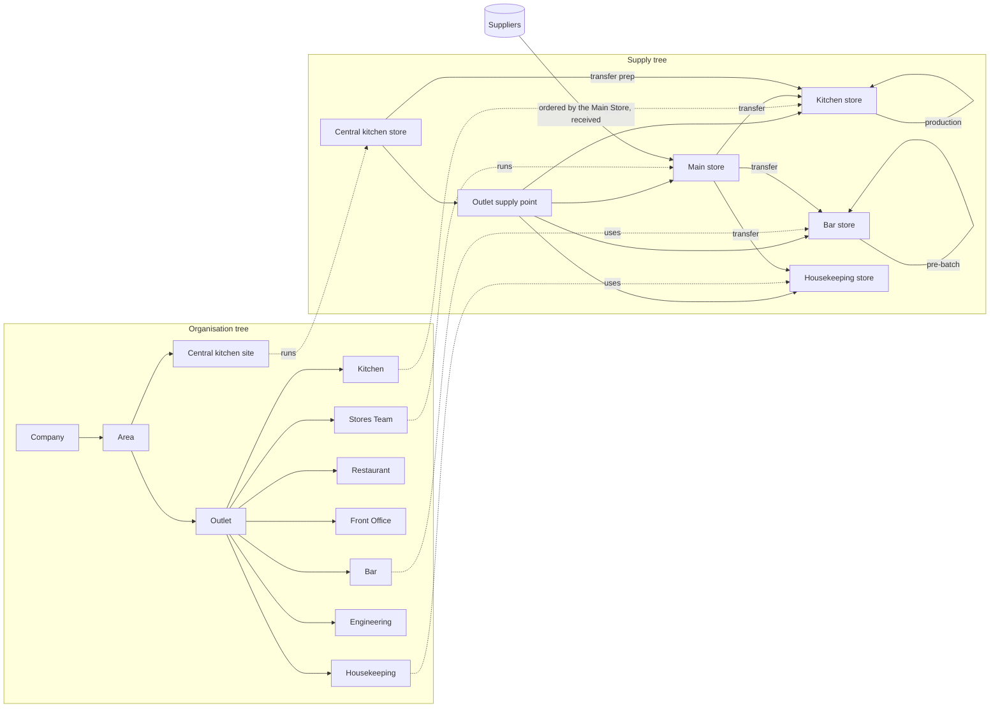

# System map: people, places and who uses what

Status: current as of 2026-10-12 (after ADR 137). This page describes what exists today;
`docs/prd.md` lists the requirements behind it and `docs/decisions/` why each was built that way.
The test customers in `docs/onboarding/test-data` and the Passport Hotel demo in
`docs/onboarding/demo/passport-hotel` are the worked examples.

## 1. Places

Every customer has **two trees** of places (ADR 009).

### The organisation tree: where people work

| Level      | Example                                                                                                                                                                                  | Notes                                                                                                                                                                                                           |
| ---------- | ---------------------------------------------------------------------------------------------------------------------------------------------------------------------------------------- | --------------------------------------------------------------------------------------------------------------------------------------------------------------------------------------------------------------- |
| Company    | Test Company                                                                                                                                                                             | the customer                                                                                                                                                                                                    |
| Region     | Test Region West                                                                                                                                                                         | optional                                                                                                                                                                                                        |
| Area       | Test Area Mumbai                                                                                                                                                                         | an area manager's patch                                                                                                                                                                                         |
| Outlet     | Test Hotel & Bar 1.0, Test Bar 3.0                                                                                                                                                       | has a format from the SOPs: `restaurant`, `bar_pub`, `qsr`, `cloud_kitchen`, `hotel` (ADR 062); has a time zone and a clock-in location                                                                         |
| Site       | Test Central Kitchen                                                                                                                                                                     | a non-selling place (central kitchen)                                                                                                                                                                           |
| Department | Kitchen, Bar, Restaurant, Front Office, Housekeeping, Banquets, Stores Team, Engineering, Security, Admin & Finance, Floor Service; at the central kitchen, Production and Dispatch Team | optional: a small outlet (Test Guest House 2.0) has none, and everyone works at the outlet. Each has a type (kitchen, service, housekeeping, other) that orders Home's Needs attention: Kitchen first (ADR 033) |

### The supply tree: where stock is kept

| Level        | Example                                                                                       | Holds stock                                                   |
| ------------ | --------------------------------------------------------------------------------------------- | ------------------------------------------------------------- |
| Network      | Test Supply Network                                                                           | no                                                            |
| Hub          | Test Central Kitchen – Store                                                                  | yes: raw materials, and the prep it makes and sends out       |
| Supply point | Test Hotel & Bar 1.0 stores                                                                   | usually no (a small outlet's supply point holds stock itself) |
| Store        | Main Store (raw materials, receives deliveries), Kitchen Store, Bar Store, Housekeeping Store | yes                                                           |

### How the two trees connect

**Node links** join them: the outlet uses its supply point, and the Kitchen department uses
the Kitchen Store.

- Pre-batched cocktails and mixers (Negroni, House Sangria, Sugar Syrup) are prep items made
  and kept in the **Bar Store**.
- Kitchen prep (Mint Chutney, Makhani Gravy) is made and kept in the **Kitchen Store**.
- The central kitchen makes prep in its hub store and transfers it to outlets.

### What is not modelled

**Tables**, **guests**, folios and stays. A hotel's rooms (file 40, with floors) carry what each
should hold, a status and its minibar, and are given to attendants per day; meals are counted by
room. But who stays in a room, their bill and their nights stay in the hotel's PMS: a room's status
is set by people in the app, not read from the PMS (see `docs/reporting.md` gaps). A restaurant's
floor is divided into sections (file 47), not tables.

## 2. People

### Two things decide what someone sees

1. **Level: how much they decide.** Doing the work, leading a shift (or running a store),
   running a department, running the outlet. This sets what they approve and whose work they
   see.
2. **Department and job: what the work is.** This sets their shifts, checklists, what they
   make, the store they use and the recipes they read.

A cook and a bartender are on the same level but do different jobs: the same rung of a
different ladder. The level is never a job description.

### The outlet, department by department (Test Hotel & Bar 1.0)

| Level ↓ / Department → | Kitchen                                         | Bar                 | Restaurant                      | Floor service (Bar 3.0) | Banquets        | Front Office                  | Housekeeping                                             | Stores          | Engineering    | Security            |
| ---------------------- | ----------------------------------------------- | ------------------- | ------------------------------- | ----------------------- | --------------- | ----------------------------- | -------------------------------------------------------- | --------------- | -------------- | ------------------- |
| Runs the outlet        | General Manager, Assistant GM (all departments) |                     |                                 |                         |                 |                               |                                                          |                 |                |                     |
| Runs a department      | Executive Chef (Head Cook in a small outlet)    | Bar Manager         | F&B Manager, Restaurant Manager | Floor Manager           | Banquet Manager | Front Office Manager          | Executive Housekeeper                                    | Purchase Mgr.   | Chief Engineer | Security Supervisor |
| Leads a shift / store  | Sous Chef                                       | Head Bartender      | Captain                         |                         | Banquet Captain | Bell Captain                  | Housekeeping Supervisor                                  | Store Keeper    |                |                     |
| Does the work          | Chef de Partie, Cook, Commis, Kitchen Steward   | Bartender, Bar Back | Steward                         | Server, Cashier, Host   | Banquet Server  | Front Desk Executive, Bellboy | Room Attendant, Public Area Attendant, Laundry Attendant | Receiving Clerk | Technician     | Security Guard      |

Above the outlet: the Area Manager (the outlets of an area) and, company-wide, the Account
Owner, HR Admin, Security Admin and Auditor. HR Executive and Cost Controller work across
one outlet. The central kitchen has its own ladder (manager, supervisor, chef, commis, store
keeper, driver).

### Same level, different job

Everyone on the "does the work" level has the same personal screens (their shifts and
clock-in, leave, tasks, My week). What differs is the job (files 06, 16, 20 and 29):

| Job (department)              | Shifts                            | Checklists                                  | Makes                                                 | Store                                     | Recipes          |
| ----------------------------- | --------------------------------- | ------------------------------------------- | ----------------------------------------------------- | ----------------------------------------- | ---------------- |
| Cook (Kitchen, Bar 3.0)       | Kitchen Evening 16:00–00:00       | Kitchen opening 11:00, closing (on shift)   | Ginger Garlic Paste, Mint Chutney                     | Kitchen Store: counts, wastage, transfers | Whole menu, no ₹ |
| Commis (Kitchen)              | Breakfast 06:00–14:00, Dinner     | Kitchen opening 07:00, fridge log every 4 h | Ginger Garlic Paste, Mint Chutney, Steamed Rice       | Kitchen Store: read only                  | Whole menu, no ₹ |
| Bartender (Bar)               | Bar Evening 17:00–01:00, Bar Late | Bar setup 17:00, Bar closing (on shift)     | Sugar Syrup, Sour Mix, pre-batched Negroni and others | Bar Store: read only                      | Whole menu, no ₹ |
| Steward (Restaurant)          | Breakfast 06:30–14:30, Dinner     | tasks from the Captain                      | nothing                                               | none                                      | Whole menu, no ₹ |
| Room Attendant (Housekeeping) | Morning 08:00–16:00, Evening      | Linen room count, Mondays 10:00             | nothing                                               | none                                      | none             |
| Public Area Attendant         | Morning, Evening                  | Lobby washroom check every 2 h              | nothing                                               | none                                      | none             |
| Laundry Attendant             | Morning 08:00–16:00               | tasks from the supervisor                   | nothing                                               | Housekeeping Store: counts, wastage       | none             |
| Front Desk Executive          | Morning, Evening, Night           | Shift handover 07:00, 15:00, 23:00          | nothing                                               | none                                      | none             |
| Technician (Engineering)      | Engineering Day 09:00–18:00       | repair requests assigned to them            | nothing                                               | none                                      | none             |
| Receiving Clerk (Stores)      | Stores Day 08:00–17:00            |                                             | nothing                                               | Main Store: counts, wastage, transfers    | none             |

The prospect-facing version, with any two jobs compared side by side, is the "Who does
what" page (`docs/who-does-what.html`; keep it in step with this table).

### Access behind it

Everyone has a **job role**. The role holds **duties** (ADR 059), such as "Runs the
department" or "Keeps the Main Store", and each duty gives default **access groups** at
places relative to their home (file 06). Extra grants come from file 08 or the Admin screens. The first
column below is the level and kind of work, not a job description.

| Level / kind of work        | Job roles (examples)                                                                                                                                                                           | Access groups                                                                               | Bottom nav                                              |
| --------------------------- | ---------------------------------------------------------------------------------------------------------------------------------------------------------------------------------------------- | ------------------------------------------------------------------------------------------- | ------------------------------------------------------- |
| Owner                       | Account Owner                                                                                                                                                                                  | ACCOUNT_OWNER (admin of the company; every report, read-only)                               | Home, To do list, Reports, Admin, Me                    |
| Area                        | Area Manager                                                                                                                                                                                   | AREA_MANAGER (view the area, approve large ones)                                            | Home, To do list, Reports, Me                           |
| Outlet head                 | General Manager, Assistant GM; Bar Manager of a bar / pub                                                                                                                                      | OUTLET_MANAGER (+ USER_ADMIN)                                                               | Home, To do list, Reports, Me                           |
| Department head             | Executive Chef, Head Cook, Bar Manager (hotel), Executive Housekeeper, Front Office Manager, F&B / Restaurant / Banquet / Floor Manager, Chief Engineer, Security Supervisor, Purchase Manager | DEPARTMENT_HEAD (+ STORE_KEEPER of their store; EVENT_PLANNER for F&B)                      | Home, Roster, Stock or Tasks, Reports, Me               |
| Supervisor                  | Sous Chef, Head Bartender, Captain, Bell Captain, Housekeeping Supervisor, Banquet Captain                                                                                                     | SUPERVISOR (+ STOCK_USER of the store)                                                      | as department head                                      |
| Store                       | Store Keeper, Receiving Clerk; Central Kitchen Store Keeper                                                                                                                                    | STORE_KEEPER / STOCK_USER                                                                   | Home, Stock, Tasks, Me                                  |
| Central kitchen             | Central Kitchen Manager, Supervisor, Chef, Commis                                                                                                                                              | HUB_MANAGER, OUTLET_MANAGER (site), STOCK_USER, PRODUCTION_TEAM                             | by kind of work                                         |
| Cost                        | Cost Controller                                                                                                                                                                                | COST_CONTROLLER                                                                             | Home, Stock, Reports, To do list, Me                    |
| Office                      | HR Executive, HR Admin, Security Admin, Auditor                                                                                                                                                | OUTLET_HR, HR_ADMIN, SECURITY_ADMIN, AUDITOR                                                | Home, To do list, Reports (if any), Admin or Roster, Me |
| Frontline that makes things | Commis, Cook, Bartender, Chef de Partie, Laundry Attendant                                                                                                                                     | STAFF + PRODUCTION_TEAM or STOCK_USER (+ MENU_READER, SUPPLY_VIEWER in food teams, ADR 165) | Home, Tasks, Me                                         |
| Frontline                   | Server, Steward, Host, Cashier, Bellboy, Front Desk, Room / Public Area Attendant, Kitchen Steward, Bar Back, Technician, Security Guard, Delivery Driver                                      | STAFF (+ SELF for everyone; + CASHIER for cashiers, ADR 039; + MENU_READER in food teams)   | Home, Tasks, Me                                         |

**One person, two jobs.** Access adds up: a person's job role gives their default access,
and extra groups can be granted on top (file 08 or Admin). The bottom nav follows their
most senior kind of work (UX-6, ADR 034): frontline staff get three tabs and four tiles
on Home; everyone's other screens are on **Me**, and the To do list sits in the header for
anyone without the tab. Rostering uses only their own job role; rostering one person in a
second role is on hold (PRD section 15, open question 7).

**A new customer from the set-up wizard** (ADR 064). Platform console → Set up a new customer:
seven screens (company, outlets, departments, roles, people, stock, who does what), saved at
every Next and resumable from "Set-ups in progress". Go live checks everything (the customer is
created and its files dry run), then applies them and sends logins: an email invitation, or a
login ID on a printed sheet for people without email.

**A new outlet from a template** (ADR 062). In the platform console, Customer → Add an outlet:
pick what it is (Hotel / Resort, Restaurant only, Restaurant + Bar, Bar / Pub, Café, Quick
service, Delivery-only kitchen) and tick what else is there; it gets its departments, stores,
roles, starter checklists and starter items, added to the customer's files and dry run as any
import. Platform console → Outlet templates shows what each starts with.

**The test customers follow the SOPs** (ADR 066). Their people hold the SOPs' roles (a
hotel's Purchase Manager heads Stores and reads its bills and Stock movements (ADR 122); a bar's Accountant verifies its stock checks), and a
test checks every test outlet against its template. Guest House 2.0's Front Desk covers its
Store Keeper; the Solo Bar's Kitchen Steward is not done.

**A role the outlet doesn't have** (ADR 061, file 37). An outlet can say another role covers
it ("no Store Keeper at Guest House 2.0: the Front Desk covers"), or that it isn't done there.
The covering role's people get the covered role's access at that outlet only, on their own
shifts, and its tasks go to one of them on duty ("Store Keeper's work (you're covering)").
A role not done there has no checklist rounds; its approvals already go up to the head or GM.

`docs/onboarding/test-data/PRODUCT_access_groups_REFERENCE.csv` says what each group
allows. `PRODUCT_roles_REFERENCE.csv` beside it is the product's role catalogue
(ADR 060): every role the SOP manuals name, with its level and default duties; a customer may
list a catalogue role by code alone. Each customer's `99_access_preview_GENERATED.csv` lists every person's access.

### Outside every customer

- **Platform admins** (`/platform`, ADR 012). They create customers, import their files and
  send logins, but never see customer data.
- **The AI agent** (planned, rule 6). It is a service user that views data and only
  proposes, through recommendations and workflow requests.

## 3. What each kind of person does in the app

| Area of the app                                                                                                        | Frontline                   | Supervisor            | Dept head                                                                | Store keeper                                        | Cost controller                      | Outlet head                                         | Area / owner / HR / audit                                        |
| ---------------------------------------------------------------------------------------------------------------------- | --------------------------- | --------------------- | ------------------------------------------------------------------------ | --------------------------------------------------- | ------------------------------------ | --------------------------------------------------- | ---------------------------------------------------------------- |
| My shifts, clock in/out, leave, swaps (swaps: managers only by default, ADR 035)                                       | ✔                           | ✔                     | ✔                                                                        | ✔                                                   | ✔                                    | ✔                                                   | HR: all leave (no screen yet)                                    |
| Clock-in selfie and device (ADR 045): a selfie at clock-in; new or shared phone flagged                                | ✔ (flagged if no camera)    |                       | sees selfies and flags (their department)                                |                                                     |                                      | sees flags, not selfies                             | HR: sees selfies and flags; area, owner: no                      |
| Roster (build, publish), attendance exceptions                                                                         | view own place              | view dept             | **build / resolve** dept                                                 |                                                     |                                      | **build / resolve** outlet                          | area: view                                                       |
| Tasks: do my tasks, report a problem                                                                                   | ✔                           | ✔                     | ✔                                                                        | ✔                                                   | ✔                                    | ✔                                                   |                                                                  |
| Tasks: give out, team view, checklists, prep list                                                                      |                             | dept                  | dept (+ edit checklists)                                                 |                                                     |                                      | outlet                                              | area: view                                                       |
| Maintenance: raise / assign / fix (All departments, To assign tab, ADR 048)                                            | raise; technician fixes     | raise                 | raise; Engineering assigns                                               | raise                                               | raise                                | assign                                              | area: view                                                       |
| Expired batches: report → assign → discard                                                                             | report; discard if assigned |                       | assign                                                                   |                                                     |                                      | assign; approve over limit                          |                                                                  |
| Production (record batches)                                                                                            | makers                      | makers                | ✔ (their store)                                                          | ✔                                                   |                                      | ✔                                                   |                                                                  |
| Stock: view (All, Running low, Expiring, Expired tabs), count, wastage                                                 | stock users                 | stock users           | ✔ (their store)                                                          | ✔                                                   | view                                 | ✔                                                   | area: view                                                       |
| Stock check (ADR 043): count blind, add a photo to each difference, finish; Verified tags                              |                             |                       | sees tags (their store)                                                  | sees tags                                           | **verifies** (or a bar's Accountant) | sees tags; told of differences                      | area: —                                                          |
| Supply requests (ADR 049): ask → approve if unusual → order → receive                                                  |                             |                       | ask (store keeper of store), no supplier or price; approves unusual ones | ask; Main Store keeper: order, receive              | view                                 | told of every request; approves too (not their own) | area: view                                                       |
| Send stock (ADR 051): Main Store → a department's store; the person on shift confirms                                  | receive task (if on shift)  |                       | gets it if nobody is on shift; Assign; told of shortfalls                | Main Store keeper: send                             |                                      |                                                     |                                                                  |
| Receiving (ADR 051): amount per item required; Bill missing flag                                                       |                             |                       | sees Bill missing                                                        | receive at amounts paid                             |                                      | sees Bill missing                                   |                                                                  |
| Vendor bills (ADR 050): add to an order, add for a service; Bills screen                                               |                             |                       | with a store: their store's (add)                                        | add to orders they receive; services at their store | view (all stores)                    | **add and view** (all stores)                       | hub manager: view; owner: totals later                           |
| Compliance (ADR 069, if bought): licences and the calendar; first card on Home; renew or mark done from the To do item |                             |                       | the calendar jobs given to their role                                    |                                                     |                                      | **keeps** (add, renew, mark done)                   | area, owner: view                                                |
| Transfers: request / dispatch / receive                                                                                | stock users request         |                       | ✔                                                                        | ✔                                                   | view                                 | ✔                                                   | hub manager dispatches                                           |
| Request for material, RFM (ADR 044): a request into a department's store                                               | stock users request         |                       | approves if off the menu or more than usual                              | issues (sends)                                      | view                                 | approves too; told of orders                        | hub manager dispatch                                             |
| Recipes (read, ADR 123, 165)                                                                                           | whole menu, no ₹            | sous chef: with costs | with costs (kitchen, bar, F&B, restaurant heads)                         |                                                     | with costs                           | with costs                                          | area, owner: costs                                               |
| Menu costs, prices, sales entry                                                                                        |                             |                       |                                                                          |                                                     | **✔**                                | ✔                                                   | area: view                                                       |
| POS import (ADR 039): upload the day's file; match POS codes                                                           | cashier: upload, match      |                       |                                                                          |                                                     | upload, match                        | upload, match                                       |                                                                  |
| Expiry (ADR 040): morning alert; Push today on Home                                                                    | service teams: Push today   |                       | alert (their store's team)                                               |                                                     |                                      | alert if no dept head; Push today                   |                                                                  |
| Report rows open their trend (ADR 041): a dish, a stock item                                                           |                             |                       | their store's items                                                      | stock items (their store)                           | ✔                                    | ✔                                                   | owner: everything, read-only                                     |
| The lists behind a figure (ADR 042): dishes, wastage, stock, people, tasks, readings                                   |                             |                       | their department, with names                                             |                                                     | dishes, wastage, stock; no names     | ✔, with names                                       | owner: everything, read-only                                     |
| Events                                                                                                                 | view (on My shifts)         | view (on My shifts)   | create (F&B)                                                             |                                                     |                                      | create                                              |                                                                  |
| To do list: approvals, To assign, To order / To receive (ADR 049)                                                      |                             |                       | leave, swaps (first); unusual requests and requests for material         | Main Store keeper: To order, To receive             |                                      | leave, swaps, orders, stock adjustments, transfers  | area / owner: escalations; security admin: role changes          |
| Reports (ADR 023)                                                                                                      | My week                     | dept today            | dept today (+ their store)                                               | My week                                             | outlet today                         | outlet today, dept today                            | area: outlets and depts; HR: depts; owner: everything, read-only |
| Cost reports (ADR 028): cost of sales, menu engineering, stock position, purchasing                                    |                             |                       | their store's                                                            | stock position, purchasing (their store)            | all four                             | all four                                            | owner: everything, read-only                                     |
| Labour cost, People, Central kitchen (ADR 030)                                                                         |                             |                       |                                                                          | Central kitchen (kitchen store keeper)              |                                      | labour cost; People (outlet HR); kitchen managers   | area, HR admin: labour; HR: People; owner: everything, read-only |
| Outlets side by side (ADR 031): the league table                                                                       |                             |                       |                                                                          |                                                     |                                      |                                                     | area manager: their area; owner: company, regions, areas         |
| Send an order to its supplier (ADR 032): WhatsApp, email, print                                                        |                             |                       | their store's orders                                                     | ✔                                                   |                                      | ✔                                                   |                                                                  |
| Targets and settings (ADR 031)                                                                                         |                             |                       |                                                                          |                                                     |                                      |                                                     | owner: changes; other admins: see                                |
| Team → People and Leave; ask to deactivate (ADR 035)                                                                   |                             |                       |                                                                          |                                                     |                                      | ✔ (WORKERS modify)                                  | HR: ✔; security admin approves the deactivation                  |
| People and access; Who does what (Admin, ADR 065)                                                                      |                             |                       |                                                                          |                                                     |                                      | outlet (user admin)                                 | owner: company; auditor: audit log                               |

**Supply requests** (ADR 049). The person who needs supplies asks for items and quantities
("Ask for supplies"), with no supplier and no price. Once approved (only unusual requests need
it), the keeper of the outlet's Main Store, or of the store itself where there is none, has it
under **To order** on the To do list: a supplier (optional, kept for the record) and a delivery
date, one order per supplier when items come from several. Then it is under **To receive**
until it is received. The department is told when it is ordered and when it is received.

**Asking for stock** (ADR 115). A department asks for items and quantities, and each goes to the
store it comes from by the outlet's shape: the Main Store where there is one, else the store that
keeps it (housekeeping's beer from the Bar), else a central kitchen; nobody picks a store. Who
approves is the outlet's own rule, chosen at onboarding (file 02, the set-up wizard): the
department head for an unusual request (the default), the GM for every one, or no one; and the
same for its purchases. The store sends it, gives it to someone of its team (a "send" task: "I
took all of it"), or buys what is short for it; whoever asked receives it, and follows it the
whole way on the request ("Waiting for Sainath to approve", "Dylan is bringing it from the Bar",
What happened). A frontline person asks their department head (Me → Ask for something), who gives
it, asks for it, or says why not; they follow it under What I asked for. An order's page names
whom it waits for, and that person approves it there.

**The Main Store keeper** (ADR 051). Orders is one list: the Main Store's own orders and the
departments' requests the keeper orders and receives, with tabs To order, To receive and
Received whose counts match their lists. Receiving fills nothing in: what arrived and the amount
paid for each item (required), for a department's order where each line goes (into the Main
Store, or straight to the department, from the item's default; ADR 080), an expiry date if it has
one, and optionally the bill; without a bill the order says **Bill
missing** to the GM, the department head and the keeper. **Send stock** gives stock to a
department's store: it leaves the Main Store at once, the person on shift there (else the head,
who can assign it on) gets a task to confirm what arrived, and a shortfall is posted as transit
loss. Every store can be sent (or ask for) any of the Main Store's materials, grouped
as Kitchen & Bar items and Housekeeping items, its own group first. On every list screen the information comes first and the buttons after it; on the Main
Store, asking for stock or supplies is a small link.

**Vendor bills** (ADR 050). A supplier's bill (photos or PDFs, number, date, amount) is added
to its order once received, by whoever receives it; a bill for a service with no stock (linen
washing, pest control, repairs) is added on **Stock → Bills** at a store the person keeps. The
Bills screen (All, Goods, Services, Waiting for a bill) shows the GM and the cost controller
every bill of the outlet's stores. A wrong bill is archived with a reason; bills are kept 7 years.

**One screen per function** (ADR 048). A count on Home opens its screen on the matching tab
with "All stores" or "All departments" chosen: running low and the expiry banners open Stock
(tabs All, Running low, Expiring, Expired); open shifts opens the roster for All departments,
a section each; attendance issues opens Exceptions; open repairs opens Maintenance on To
assign; Receive and Send open Orders on To receive and Transfers on To send.

Roster has two sides (ADR 025): **Me** (My shifts, Clock, Leave, Swaps) for everyone who
works shifts, and **Team** (Roster, Exceptions, Events, and People and Leave for those who manage worker
records, ADR 035) for people who build rosters, resolve exceptions or plan events, and for
people above outlet level. Frontline staff see
only Me.

**Customer access groups** (ADR 027). A company may build its own groups from the product's
rights (Admin → Access groups, Account Owner; or file 05). A group can carry a role's
requests and approvals: Test Company's Kitchen Lead (Sous Chef 1.1, Hotel 1.1 kitchen)
approves like the department head.

**Building blocks** (ADR 026, 067, 085). Every group of functionality is a block a customer has
or not, sold in bundles: Stock & buying (Stores & stock, Supply requests & orders), Kitchen & bar
(Recipes & costing, Production, Prep lists, Menu and sales), People (Roster, Clock-in, Salaries &
labour cost, Leave, Shift swaps), Daily work (Checklists, Maintenance, Today's briefing), Hotel
(Room minibars; out of a plan unless put in) and Events & compliance (Events, Compliance; off
unless switched on). Places and people, access, To do, approvals, notifications, Home, Me, Admin
and reports have no switch. What is off disappears from the table above for everyone in that
company, and the database refuses it. Only a platform admin switches blocks and bundles, on the
console's customer page or in file 00; Admin → Your plan shows them read-only. Test Company has
everything; Test Solo Bar Co. has Events and Swaps off, no Hotel bundle and no Compliance.

**Today's briefing** (ADR 070). A note for the outlet's shift: words, and the dishes that are
"Off today". It shows on Home, above Push today, for everyone who works at the outlet, for the
business day (whole day, lunch until 16:00, dinner from 16:00). Written on `/briefing` (Me →
Today's briefing) by the heads of kitchen and service departments (the duty "Writes the shift
briefing", group BRIEFING_WRITER) at their department, by the outlet's managers at the outlet
or any department, and by whoever covers a writer. One note per place and part of the day;
saving again edits it, "Take down" archives it. No module: it comes with every plan.

**Minibars** (ADR 072). A hotel's rooms (file 40), each with a minibar set (file 41: items, par,
price, the store it refills from). Me → Minibars: Rooms (when each was last checked), To charge
(what front office still has to add to bills, "Added to the bill") and Sold (7 or 30 days).
Checking a room counts what is left; what is missing is charged. The refill is a To do item for
whoever checked ("Refilled" takes the stock from the store as a consumption) and the bill one for
the front desk on shift ("Added to the bill" closes it and tells housekeeping; ADR 081).
Housekeeping and front office hold the duty "Checks the rooms' minibars" (MINIBAR_KEEPER at the
outlet); the outlet's managers too; area managers see.

**Show as someone** (ADR 071), test customers only. A demo presenter (file 07) opens Me → Show
the app as someone and picks a person of their company; every screen is then theirs, under an
amber banner with Switch and Back to. The database checks it on every request, audit rows say
who presented, and nothing touches a login meanwhile.

**Building blocks round 2** (ADR 087 to 096, all on by default; a platform admin switches them).

- _Checklists_: a finished round may need signing off (one level up, the department head or a
  named role; a To do item), schedules may be monthly or the nth weekday, steps may run on some
  weekdays only, readings ask what food and whether it was thrown, and a checklist may run per
  room or per area as a grid; rooms carry a status shown as a word, never a code: Clean, Dirty,
  Guest in, Arriving, Departing, Out of order (ADR 087, 088, 104, 131).
- _Logbook & handover_ (LOGBOOK): entries per place and a handover acknowledged by whoever it is
  for. _Registers_ (REGISTERS): lost and found, incidents, visitors, vehicles, staff in and out,
  keys, fire equipment, each kept by the roles file 45 names. _Utilities_ (UTILITIES): meters
  read daily by a job role, consumption by day (ADR 089 to 091).
- _Stock policies_: par by weekday, items thrown away only once the GM approves, and which
  orders need approving (unusual, every, above an amount) (ADR 092).
- _Shelf life & labels_ (SHELF_LIFE): an opened pack's use-by and its label with day dot;
  _Breakage_ (BREAKAGE): what broke, where and how, posted as consumption (ADR 093).
- _Allergens_ (no block of their own): one list of 14, FSSAI's nine and the EU's five. A raw item
  is tagged once; every prep item and dish made with it carries them, on its label, its prep
  task and its recipe page (ADR 138).
- _Rooms_ (ROOMS): what each room should hold, counted not stocked; each room's status with its
  time, or why it is out of order, until when and its repair (ADR 117); breakfast, lunch and
  dinner by room, set by the restaurant (service) team and read by the kitchen, front office and
  housekeeping (ADR 121). _Linen & uniforms_
  (LINEN): the laundry exchange and uniforms issued (ADR 094).
- _Audits_ (AUDITS): yes/no and 1 to 5 checklists scored as a %; _Training & SOPs_ (TRAINING):
  Me → SOPs with "I've read this" per version, sessions with attendance and scores (ADR 095).
- _Excise_ (EXCISE): a store's daily bar register and FLR from the ledger, and transport
  permits; _covers_ per meal on the outlet's day report, with the spend per cover (ADR 096).

**The roster** (ADR 082, 128, 130, 132, 135). By person (a department head's default) or by shift.
By person is a row each with a tile per shift type of the department (straight, split or panzer),
a Custom tile and Off; a tap puts anyone on any type, another role's too, and every rule runs
again. Changes wait: drafts, and people put on or taken off a published shift, are counted in
**Publish (N)** and nobody is told until it is pressed; **Start again** undoes every change not yet
published. "Repeat this pattern" copies a week forward.

**Rooms, meals and sections** (ADR 110, 111, 117, 121, 131, 133, 136). Rooms are tiles coloured by
their status word; tap one, tap the new status (Arriving and Departing carry a time; Out of order a
reason, an until-day and its repair). Whoever runs housekeeping gives rooms to attendants per day,
a whole floor in one tap; an attendant sees theirs first. The restaurant team sets breakfast,
lunch and dinner by room (a tapped room starts at 2 guests, a floor in one tap), read by the
kitchen, front office and housekeeping. A restaurant's floor manager gives sections (Section 1 to
3 at Passport) to servers per day, a row per person, confirmed with Save changes; Home says "Your
section today".

**Me** (ADR 106, 125, 132). Clock, My shifts, Leave, SOPs and Report a problem first, then the
person's own work under headings: My work, My day, Team, Admin, More. Nothing is folded.

**An item's page** (ADR 134). Its photo and what is on hand, its five latest movements with Show
all, its open requests and where each is, then **Ask for more**: from the store that keeps it, else
a supply request, the form opening with the item first.

**Alerts on the phone** (ADR 137). Everything that lands in the 🔔 also shows on the phone's lock
screen within a minute, for the phones its owner turned alerts on for: Home asks once, Profile →
Alerts on this phone turns them on or off. An iPhone needs the app on its Home Screen first.

### Approval processes (To do list)

LEAVE, SHIFT_SWAP, PURCHASE_ORDER (by the outlet's own rules, ADR 115: only unusual ones by
default, ADR 044: off the menu or more than usual; the department head or the GM; no value limit
and no area manager step, ADR 049), STOCK_ADJUSTMENT
(old-count differences beyond tolerance, wastage over the limit, delivery excess; a stock
check difference needs no approval, ADR 043), TRANSFER (a request for material that is off the
menu or more than usual first goes to the department head or the GM), ROLE_CHANGE, DEACTIVATION (a leaver, approved by the
security admin, ADR 035).

The chain walks up from the place to whoever holds the group, and ends at the Account
Owner (ADR 010). The person who started a request never approves it.

### Background jobs

- **Executor** (every minute): carries out approved requests, then sends each new notification to
  its owner's phones (ADR 137).
- **Nightly** (02:15): attendance exceptions, the location purge and the removal of
  selfies and devices past the retention rule (ADR 045), then the report tables for the
  last 35 days (ADR 023).
- **Tasks tick** (every 5 minutes): checklist rounds, reminders, escalation; licence
  renewals 90 days ahead and compliance jobs 14 days ahead (ADR 069).
- **Platform worker**: creates customers and runs imports.

## 4. The diagram

The interactive version (pick a role, see their nav, places and flows) is published at
https://claude.ai/artifact/676WtVzMV2GwfsuaDB3Eot (private to the owner until shared). The Mermaid
version below is the same map, kept here so it stays with the code.

